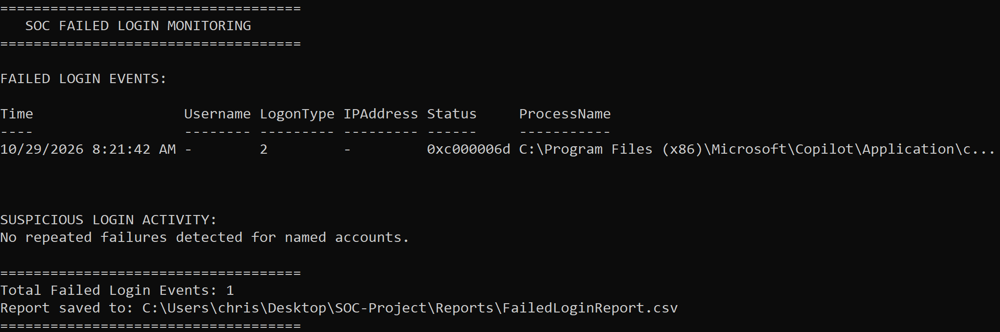
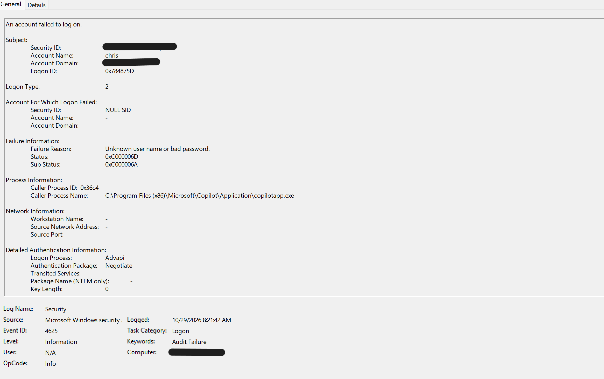
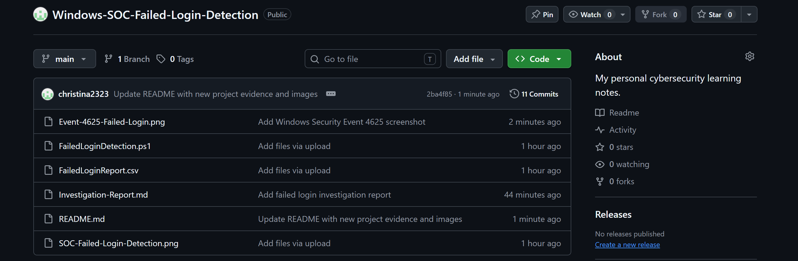

## **Windows SOC – Security Log Monitoring and Failed Login Detection**

##### **Project Overview**

This beginner-level cybersecurity project demonstrates basic Security Operations Center (SOC) monitoring using Windows Security Event Logs and PowerShell.

The project collects failed login events, extracts relevant security information, identifies repeated failed login attempts for named accounts, and exports investigation results into a CSV report.

##### **Objectives**

\- Monitor Windows Security Event ID 4625.

\- Extract login timestamps and authentication details.

\- Identify repeated failed login attempts.

\- Perform basic security event investigation.

\- Generate CSV investigation reports.

##### **Tools and Technologies**

\- Windows 10 Home

\- Windows PowerShell

\- Windows Security Event Logs

\- Event Viewer

\- Microsoft Excel

\- GitHub

##### **Security Event IDs**

| Event ID | Description |

|---|---|

| 4624 | Successful logon |

| 4625 | Failed logon |

##### **Detection Logic**

The PowerShell script retrieves up to 50 recent failed login events.

It groups events by username and flags accounts with five or more failed attempts in the collected results.

This is a basic demonstration rule and does not independently confirm malicious activity.

##### **Project Structure**

SOC-Project/

├── Scripts/

│   └── FailedLoginDetection.ps1

├── Reports/

│   └── FailedLoginReport.csv

├── Logs/

└── README.md

##### **Results**

\- Successfully retrieved Windows Security Events.

\- Extracted failed authentication details.

\- Implemented basic repeated-login detection.

\- Generated a CSV investigation report.

##### **Learning Outcomes**

\- Windows Security Event Log analysis

\- PowerShell scripting

\- Basic threat detection

\- Security event investigation

\- SOC monitoring fundamentals

\- Incident documentation

##### **Disclaimer**

This project was developed for educational purposes using security logs from my own Windows computer. Detection results are preliminary indicators and should be investigated before classifying activity as malicious.

## Project Evidence

### Failed Login Detection – PowerShell Output

### Windows Security Event – 4625

### GitHub Repository Overview

### Investigation Report

[View Failed Login Investigation Report](Investigation-Report.md)
